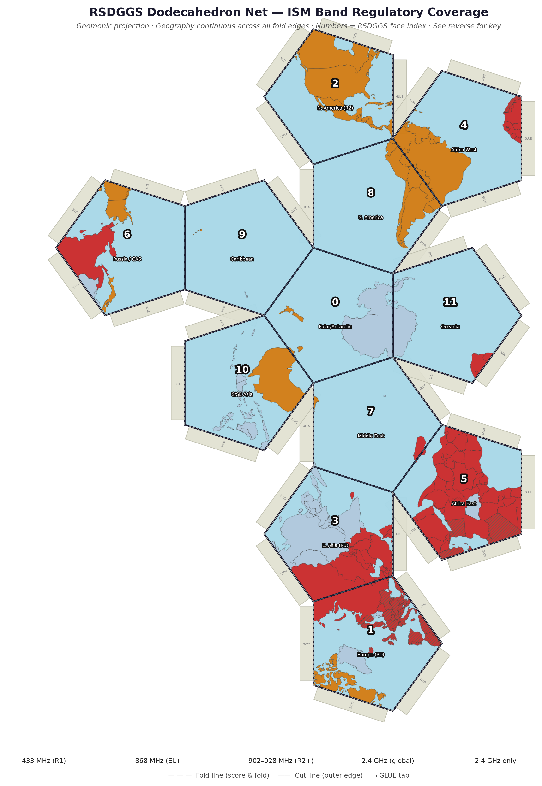

# RSDGGS — Radio Spectrum Discrete Global Grid System

Rust reference implementation of the RSDGGS wire format, encoder, decoder, and sub-GHz regulatory lookup database.

---

## Overview

RSDGGS is a hierarchical global grid that maps every point on a celestial body to a compact 1–8 octet binary index.  The grid is built on the dual of a regular icosahedron (a dodecahedral tiling of 12 pentagonal faces), with each face recursively subdivided into four triangular children at each resolution level.

This crate provides:

- **Encode** — convert (lat, lon, depth) → `RsdggsIndex`
- **Decode** — convert `RsdggsIndex` → geographic bounding cell and center
- **Wire I/O** — pack/unpack a 64-bit big-endian wire value
- **Regulatory lookup** — query the sub-GHz ISM band database for a face
- **CBOR schema** — CDDL-driven minicbor serializers for all index and cell types
- **CLI test tool** — interactive encode/decode with regulatory and metro context output

---

## Flatend Dodecahedron Projection of Regulatory Bodies

---

## Wire Format

The RSDGGS wire value is a 64-bit big-endian unsigned integer packed MSB-first:

```
Bit  63–60   Body selector   (4 bits)  0x0=Earth, 0x1=Moon, 0x2=Mars
Bit  59–56   Face            (4 bits)  0–11
Bit  55–53   Triangle        (3 bits)  0–4  (omitted at depth 1)
Bit  52– 7   Subdivision     (2 bits × up to 26 levels)
Bit      0   Reserved        (1 bit)   must be zero
```

Octet depth (1–8) determines how many bits are significant.  Depth 1 encodes body+face only (continental resolution).  Depth 8 encodes all 26 subdivision levels (~centimeter resolution).

| Depth | Bits used | Approx. cell diameter |
|------:|----------:|----------------------:|
|     1 |         8 | ~3 000 km             |
|     2 |        16 | ~600 km               |
|     3 |        24 | ~150 km               |
|     4 |        32 | ~40 km                |
|     5 |        40 | ~10 km                |
|     6 |        48 | ~2.5 km               |
|     7 |        56 | ~600 m                |
|     8 |        64 | ~150 m                |

---

## Coordinate System and Face Layout

The icosahedron is rotated so that **Face 2 is anchored at 39°N 98°W** (central Kansas, USA), chosen as the reference anchor for the Americas ITU Region 2 allocation.

| Face | Region label           | Approximate center     | ITU Region |
|-----:|------------------------|------------------------|-----------|
|    0 | Polar/Antarctic        | 65.6°S  172.0°E        | 1 / 3     |
|    1 | Europe                 | 65.6°N    8.0°W        | 1         |
|    2 | N. America (anchor)   | 31.4°N  102.5°W        | 2         |
|    3 | E. Asia                | 31.4°N   86.5°E        | 3         |
|    4 | Africa West            |  6.2°N   39.9°W        | 1         |
|    5 | Africa East            |  6.2°N   23.9°E        | 1         |
|    6 | Russia / C. Asia       | 51.0°N  172.0°E        | 1         |
|    7 | Middle East            | 31.4°S   77.5°E        | 1 / 3     |
|    8 | S. America             | 31.4°S   93.5°W        | 2         |
|    9 | Caribbean / Pacific    |  6.2°S  156.1°W        | 2         |
|   10 | S/SE Asia & Oceania    |  6.2°S  140.1°E        | 3         |
|   11 | Oceania / S. Pacific   | 51.0°S    8.0°W        | 3         |

Face centers and pentagon vertices are stored as f64 unit-vector triples in `src/constants.rs`.  They are derived analytically from the rotated icosahedron; no external dataset is used.

---

## Source Modules

| File | Purpose |
|------|---------|
| `src/lib.rs` | Crate root — re-exports and `Error` enum |
| `src/types.rs` | `Body`, `RsdggsIndex`, `BoundingCell`, `BandEntry`, supporting enums |
| `src/constants.rs` | Icosahedron face centers and pentagon vertices (static f64 arrays) |
| `src/encode.rs` | lat/lon → `RsdggsIndex` via spherical triangle subdivision |
| `src/decode.rs` | `RsdggsIndex` → `BoundingCell` (vertices + geographic bbox) |
| `src/wire.rs` | `to_wire` / `from_wire` / `truncate` — 64-bit pack/unpack |
| `src/bits.rs` | `BitReader` / `BitWriter` — MSB-first bit I/O primitives |
| `src/cbor.rs` | `include!()` wrappers for cddlc-generated minicbor code |
| `src/regulatory/mod.rs` | `lookup` and `bands_for_face` entry points |
| `src/regulatory/earth.rs` | Static `BandEntry` records and face→band lookup table |
| `src/cities.rs` | ~280-entry world metro database; `metro_context` lookup |
| `cddl/rsdggs.cddl` | CDDL schema for index, wire, bounding cell, lookup messages |
| `cddl/regulatory.cddl` | CDDL schema for band entry and regulatory response |
| `build.rs` | Runs `cddlc` at build time; strips crate-level attrs from output |
| `src/bin/rsdggs-tool.rs` | CLI test tool (encode / decode subcommands) |

---

## CDDL Schemas and Code Generation

The two schemas in `cddl/` are compiled at build time by `cddlc` into minicbor
Rust serializers, which are then `include!()`'d into `src/cbor.rs`.

```
cddl/rsdggs.cddl     → $OUT_DIR/rsdggs_cbor.rs
cddl/regulatory.cddl → $OUT_DIR/regulatory_cbor.rs
```

`build.rs` invokes `cddlc` via the shell, strips inner `#![...]` crate attributes
from the output (they are invalid inside a module block), and writes the cleaned
file to `$OUT_DIR`.

**Known schema gap — `.size` range constraint:** The CDDL expression
`rsdggs-wire = bstr .size 1..8` is not yet supported by the cddlc parser
(`lower_size()` handles only exact integer sizes, not range operands).
As a workaround the schema declares `rsdggs-wire = bstr` with no size constraint;
the 1–8 octet range is enforced at runtime in `from_wire()`.

---

## Dependencies

### Library (`[dependencies]`)

| Crate | Version | Purpose |
|-------|---------|---------|
| `libm` | 0.2 | Portable math (`sin`, `cos`, `sqrt`, `asin`) used in `encode.rs` and `decode.rs`.  Chosen over `std::f64` because it enables future `no_std` porting without changing call sites. |
| `minicbor` | ≥ 2 (features: `derive`, `alloc`) | CBOR encoding and decoding for all cddlc-generated types.  The `derive` feature enables the `#[derive(Encode, Decode)]` macros; `alloc` is required so that `Vec<T>` implements `Decode`. |

### Test harness (`[dev-dependencies]`)

| Crate | Version | Purpose |
|-------|---------|---------|
| `approx` | 0.5 | `assert_abs_diff_eq!` macro for floating-point equality checks in `tests/roundtrip.rs`. |

### Build tool

| Tool | Source | Purpose |
|------|--------|---------|
| `cddlc` | Internal — `cddlc-projects/cddlc` | CDDL compiler that generates Rust minicbor code from `.cddl` schemas.  Must be on `PATH` or pointed to via the `CDDLC` environment variable. |

No external network services are used at build time or runtime.  All geographic constants, the regulatory database, and the metro reference data are embedded as static arrays.

---

## CLI Test Tool

```
cargo run -- encode <lat> <lon> [--depth N] [--truncate N]
cargo run -- decode <value>     [--depth N] [--truncate N]
```

`<value>` accepts decimal (`146230399339593728`) or `0x`-prefixed hex (`0x020783c600000000`).

`--depth N` (1–8, default 8) sets octet precision for encode, or declares how many
octets of a decoded wire value are significant.

`--truncate N` reduces the resolved index to N-octet precision and emits warnings
when that resolution is too coarse for reliable regulatory determination.

**Example output:**

```
────────────────────────────────────────────────────────────────
 RSDGGS ENCODE
────────────────────────────────────────────────────────────────
 Input
   Latitude  :    39.000000°
   Longitude :   -98.000000°
   Depth     :  4 octets

 Index
   Body     : Earth (0x0)
   Face     : 2  [N. America (anchor)]
   Triangle : 0
   Levels   : [0, 3, 3, 0, 0, 1, 3, 2, 0, 3]  (10 steps)

 Wire Value
   Hex     : 0x020783c600000000
   Decimal : 146230399339593728

 Bounding Cell
   Latitude  :   38.98079° – 39.01768°  (span 0.0369° / ~4.1 km)
   Longitude :  -98.02366° – -97.97584°  (span 0.0478° / ~4.1 km)
   Area      :  ~16.892 km²
   Center    :  38.998229°N, 98.006228°W
   Metro     :  ~157 km from Wichita

 Regulatory  (Face 2 / Earth — N. America (anchor))

   [1]  FCC  902–928 MHz
        Citation    : 47 CFR 15.247
        Power       : 1000 mW  (conducted)
        Hop req.    : yes  (min 50 channels)
        LBT         : no
        Duty cycle  : unrestricted
        Available   : YES
────────────────────────────────────────────────────────────────
```

---

## Regulatory Database

The regulatory database in `src/regulatory/earth.rs` covers the sub-GHz ISM
bands relevant to unlicensed LPWAN and short-range device operation.  Each entry
is a static `BandEntry` struct, keyed by RSDGGS face number.

### Populated Entries

| Band ID | Face | Authority | Frequency | Citation |
|--------:|-----:|-----------|-----------|---------|
| 1 | 2 (N. America) | FCC | 902–928 MHz | [47 CFR §15.247](https://www.ecfr.gov/current/title-47/chapter-I/subchapter-A/part-15/subpart-C/section-15.247) |
| 2 | 1 (Europe) | ETSI | 433.05–434.79 MHz | [ETSI EN 300 220-1](https://www.etsi.org/deliver/etsi_en/300200_300299/30022001/) |
| 3 | 1 (Europe) | ETSI | 863–870 MHz | [ETSI EN 300 220-2](https://www.etsi.org/deliver/etsi_en/300200_300299/30022002/) |
| 4 | 10 (S/SE Asia & Oceania) | ACMA | 915–928 MHz | [ACMA Radiocommunications (Low Interference Potential Devices) Class Licence 2015](https://www.legislation.gov.au/Details/F2015L01438) |

### Regulatory Coverage Gaps

The following faces currently have **no regulatory entries** in the database.
Queries against these faces return an empty iterator and a `WARNING` from the tool.

| Face | Region | Notes |
|-----:|--------|-------|
| 0 | Polar/Antarctic | Antarctic Treaty System; no sovereign domestic spectrum authority.  COMNAP/SCAR coordination required. |
| 3 | E. Asia | MIIT (China), MIC (Japan), KCA (Korea) — distinct national frameworks, not yet entered. |
| 4 | Africa West | ECOWAS member regulators; most follow ITU R1 432/868 MHz but many lack published ISM rules. |
| 5 | Africa East | Similar gap to Face 4. |
| 6 | Russia / C. Asia | Roskomnadzor; 864–865 MHz restricted; 902–928 MHz reserved for military.  Not yet entered. |
| 7 | Middle East | Fragmented — TDRA (UAE), CITC (Saudi Arabia), TRC (Jordan) differ significantly. |
| 8 | S. America | ANATEL (Brazil), SUBTEL (Chile), CRC (Colombia) — partial alignment with 902–928 MHz but with national carve-outs. |
| 9 | Caribbean / Pacific | Mix of FCC-aligned territories and independent regulators (URCA, TRC-BVI). |
| 11 | Oceania / S. Pacific | RSM (New Zealand) follows ACMA 915–928 MHz but is mapped to Face 10, not Face 11. |

**Contributing regulatory data:** Add a `BandEntry` constant to `src/regulatory/earth.rs`
and register it in `EARTH_TABLE` with the appropriate face number.

---

## Known Implementation Gaps

### Moon and Mars (Body Selectors 0x1, 0x2)

The wire format reserves 4 bits for a celestial body selector.  Three bodies are
currently decoded: `Earth` (0x0), `Moon` (0x1), `Mars` (0x2).

**What works:** The `from_wire()` and `to_wire()` functions correctly decode the
body nibble for all three values.  Wire values with Moon or Mars body selectors
round-trip without error.

**What is not implemented:**

| Gap | Detail |
|-----|--------|
| **Selenographic coordinates** | The Moon uses a Mean Earth / Polar Axis (ME) principal axis reference frame (IAU WGCCRE).  No lunar face centers or pentagon vertices are defined.  `encode()` is Earth-only and returns `Error::NonEarthNotSupported` for other bodies. |
| **Areographic coordinates** | Mars uses the IAU Mars Mean Equator and IAU-node of epoch frame, with the prime meridian fixed by the Airy-0 crater.  Not implemented. |
| **Regulatory lookup** | `bands_for_face()` returns an empty iterator for non-Earth bodies.  No spectrum management frameworks exist for the Moon or Mars at present. |
| **Decode / bounding cell** | `decode()` uses Earth-centric face geometry.  Calling it on a Moon or Mars index produces a geographic coordinate that is meaningless but does not panic. |

**To add a body:** Define face centers and pentagon vertices for the body's
coordinate system in a new constants file, add a match arm in `encode()`,
and add a body-specific table in `src/regulatory/`.

### Additional Known Limitations

- **Face boundary points** fall into the nearest face by dot-product fallback.
  Points exactly on a face edge or vertex are assigned deterministically but the
  specific face is implementation-defined (not specified by the standard).
- **Cell area estimate** in the CLI tool uses a flat-earth approximation
  (`lat_span_km × lon_span_km`).  Actual spherical triangle areas differ slightly
  at high latitudes.
- **Metro context** uses centroid-distance heuristics (~280 cities) and an
  estimated urban radius of `√pop_M × 15 km`.  It is informational only and not
  part of the RSDGGS specification.

---

## Test Suite

Unit and integration tests live in `tests/roundtrip.rs`.  Run with:

```
cargo test
```

Current coverage (11 tests):

| Test | What it verifies |
|------|-----------------|
| `anchor_point_face2` | 39°N 98°W encodes to Face 2 |
| `roundtrip_depths_1_to_8` | Encode→decode round-trip for 6 global cities at all 8 depths |
| `cell_shrinks_with_depth` | Bounding cell area decreases monotonically with depth |
| `cell_center_near_input` | Cell centroid is within 1° of the encoded point at depth 6 |
| `regulatory_fcc_face2` | FCC entry: 902 MHz, 1000 mW conducted, 50-channel hop set |
| `regulatory_etsi_face1` | ETSI 433 MHz: 10% duty cycle; ETSI 868 MHz: 863 MHz lower edge |
| `regulatory_acma_face10` | ACMA entry: 915 MHz lower edge |
| `regulatory_missing_returns_err` | Unknown band ID returns `Err(BandNotFound)` |

---

## Airport Validation Script

`regulatory_locations.sh` tests the encode/decode pipeline against 24 reference
locations — the busiest airports in each ITU regulatory zone — and validates that
the tool produces sensible regulatory context at all truncation depths.

The script is organized by ITU region:

**ITU Region 1 — Europe, Africa, Middle East, Northern Asia**

| # | Country | Airport | ICAO | Coordinates |
|---|---------|---------|------|-------------|
| 1 | United Kingdom (Ofcom/CEPT) | London Heathrow | LHR | 51.4700°N, 0.4543°W |
| 2 | Ireland (ComReg) | Dublin | DUB | 53.4273°N, 6.2436°W |
| 3 | Netherlands (RDI) | Amsterdam Schiphol | AMS | 52.3091°N, 4.7634°E |
| 4 | Switzerland (OFCOM/BAKOM) | Zurich | ZRH | 47.4582°N, 8.5555°E |
| 5 | Hungary (NMHH) | Budapest Ferenc Liszt | BUD | 47.4330°N, 19.2616°E |
| 6 | Iceland (Fjarskiptastofa) | Keflavík | KEF | 63.9850°N, 22.6056°W |
| 7 | United Arab Emirates (TDRA) | Dubai International | DXB | 25.2528°N, 55.3644°E |
| 8 | Russian Federation (Roskomnadzor) | Sheremetyevo | SVO | 55.9726°N, 37.4146°E |
| 9 | Egypt (NTRA) | Cairo International | CAI | 30.1219°N, 31.4056°E |
| 10 | Liberia (LTA) | Roberts International | ROB | 6.2339°N, 10.3622°W |
| 11 | South Africa (ICASA) | O.R. Tambo | JNB | 26.1367°S, 28.2460°E |

**ITU Region 2 — The Americas and Greenland**

| # | Country | Airport | ICAO | Coordinates |
|---|---------|---------|------|-------------|
| 12 | United States (FCC) | Hartsfield–Jackson Atlanta | ATL | 33.6407°N, 84.4277°W |
| 13 | Canada (ISED) | Toronto Pearson | YYZ | 43.6771°N, 79.6335°W |
| 14 | Mexico (IFT) | Mexico City Benito Juárez | MEX | 19.4363°N, 99.0721°W |
| 15 | Brazil (ANATEL) | São Paulo/Guarulhos | GRU | 23.4356°S, 46.4731°W |
| 16 | The Bahamas (URCA) | Lynden Pindling | NAS | 25.0390°N, 77.4662°W |
| 17 | British Virgin Islands (TRC) | Terrance B. Lettsome | EIS | 18.4485°N, 64.5430°W |

**ITU Region 3 — Asia-Pacific**

| # | Country | Airport | ICAO | Coordinates |
|---|---------|---------|------|-------------|
| 18 | China (MIIT) | Shanghai Pudong | PVG | 31.1443°N, 121.8083°E |
| 19 | Hong Kong SAR (OFCA) | Hong Kong International | HKG | 22.3080°N, 113.9185°E |
| 20 | India (WPC) | Indira Gandhi International | DEL | 28.5562°N, 77.1000°E |
| 21 | Japan (MIC) | Tokyo Haneda | HND | 35.5494°N, 139.7798°E |
| 22 | Australia (ACMA) | Sydney Kingsford Smith | SYD | 33.9461°S, 151.1772°E |
| 23 | New Zealand (RSM) | Auckland | AKL | 37.0081°S, 174.7917°E |

**Esoteric / Antarctica**

| # | Location | Airfield | Coordinates | Notes |
|---|----------|----------|-------------|-------|
| 24 | McMurdo Station / Ross Dependency | Phoenix Airfield (NZFX) | 77.9564°S, 166.7667°E | Antarctic Treaty System; COMNAP/SCAR coordination |

The script also runs a decode pass over a pre-computed set of wire values at
truncation depths 7, 5, 3, and 1 to validate the inverse path, and a small
set of non-Earth body selectors (Moon, Mars) to confirm that unsupported bodies
decode without panicking.

Run the script from the crate root:

```bash
chmod +x regulatory_locations.sh
./regulatory_locations.sh 2>&1 | less
```

---

## Building

### Prerequisites

| Tool | Version | Notes |
|------|---------|-------|
| Rust toolchain | 2024 edition or later | `rustup update stable` |
| `cddlc` | — | Must be on `PATH`, or set `CDDLC=/path/to/cddlc` |

### Build

```bash
cargo build
```

If `cddlc` is not on `PATH`:

```bash
CDDLC=/path/to/cddlc cargo build
```

### Run tests

```bash
cargo test
```

### Run the CLI tool

```bash
# Encode a coordinate
cargo run -- encode 51.5 -0.1 --depth 6

# Decode a wire value (hex or decimal)
cargo run -- decode 0x014327184d057230

# Decode with known depth and truncation
cargo run -- decode 0x014327184d057230 --depth 7 --truncate 4
```
